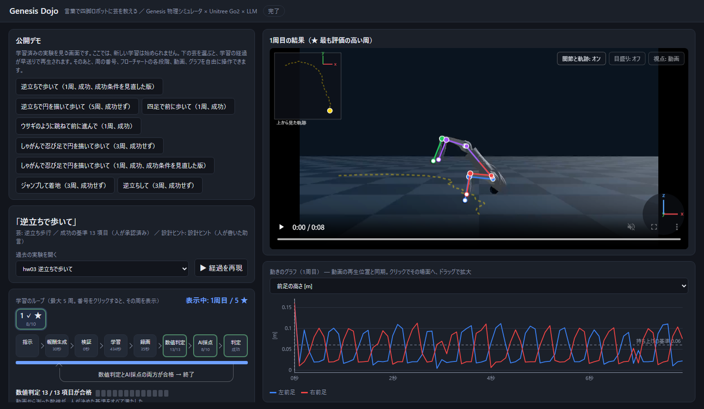
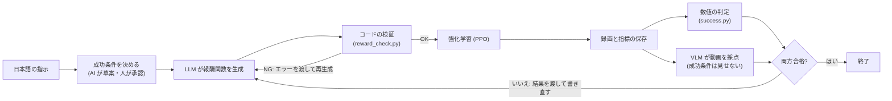

# Genesis Dojo

日本語の指示で四脚ロボット（Unitree Go2）に芸を教えるシステムと Web UI。

LLM が報酬関数を書き Genesis 上で PPO により学習する。学習結果は数値の基準と VLM の採点で評価し 不合格なら結果を渡して報酬を書き直す。



## 流れ



## 構成要素

| # | 要素 | 内容 |
|---|---|---|
| 1 | 成功条件 | 録画から計算した数値（体の傾き・高さ・進んだ距離・足の持ち上げ回数など）に付ける基準の一覧。AI が草案を作り 人が承認する。承認後は変更しない。 |
| 2 | 報酬関数 | LLM が書く Python コード。`pai_loop/rewards/generated/` に保存。 |
| 3 | 学習 | PPO（rsl_rl）。各周ゼロから学習し 重みは引き継がない。 |
| 4 | 評価 | 数値の判定と VLM の採点。両方合格で成功。VLM には成功条件も報酬コードも見せない。 |
| 5 | 改善ループ | 不合格のとき 前の周の報酬コード・不合格の基準・VLM の指摘を LLM に渡して書き直す（最大 3 周） |
| 6 | 成功条件の見直し | 結果が思わしくないとき AI が見直し案を作り 人が承認して再学習する。前の実験の最良の周の報酬コードと指摘を引き継ぐ。 |
| 7 | LLM・VLM | Claude Code の非対話モード（`claude -p`）経由 |

## 必要なもの

- NVIDIA GPU（L4 24GB で動作を確認）
- Python 3.12・Genesis 1.4.4・rsl-rl-lib 5.5.1・PyTorch ほか（[VERSIONS.md](VERSIONS.md)）
- PyYAML
- Claude Code（`claude` コマンド・ログイン済み）
- ffmpeg（動画の圧縮スクリプトのみ）

## 使い方

リポジトリのルートで実行する。

Web UI

```bash
python -m dashboard.server --root . --port 8765
```

http://127.0.0.1:8765/ を開き 指示を入力して「学習を始める」を押す。成功条件の草案を確認して承認すると学習が始まる。操作の詳細は [dashboard/README.md](dashboard/README.md)。GPU のない環境では `--no-run` で記録済みの実験の閲覧のみ。

コマンドライン

```bash
python scripts/loop.py --exp demo_sit --instruction "お座りして" \
  --success-spec configs/tasks/sit.success.yaml --max-loops 3
```

`--success-spec` には承認済み（`approved: true`）の成功条件が必要。未承認のものは起動しない。

| # | 目的 | コマンド |
|---|---|---|
| 1 | 1 回だけ学習（手書きの報酬） | `python scripts/train.py configs/exp01_sit.yaml` |
| 2 | 学習した方策を録画 | `python scripts/record.py exp01_sit` |
| 3 | 録画の結果を成功条件で判定（GPU 不要） | `python scripts/check_success.py demo_sit_L2 --spec configs/tasks/sit.success.yaml` |
| 4 | テスト（GPU 不要） | `python -m unittest discover -s tests` |

## 公開デモ

https://genesis-dojo.vercel.app

`demo/` に 学習済みの実験を閲覧するだけの静的サイトを置いている。サーバー・LLM・GPU は不要で 新しい学習は始められない。

- 内容は Web UI と同じ画面（学習の経過・各周の結果・動画・関節の重ね描き・グラフ）
- 手元での確認: `cd demo && python -m http.server 8000` → http://127.0.0.1:8000/
- 公開: `demo/` を静的サイトとして配置（Vercel は Root Directory を `demo`・Framework を Other・Build Command を空に設定）
- 実験の追加: 記録のある環境で `python scripts/export_static.py --root . --out demo --exps <実験名,...>`

## ディレクトリ

```text
.
├── pai_loop/          環境・報酬の枠・成功条件の判定・LLM と VLM の呼び出し・プロンプト
│   ├── sim/           シミュレータの抽象化と Genesis 実装
│   └── rewards/       報酬モジュール（generated/ に LLM が書いた報酬）
├── configs/           実験の設定
│   ├── tasks/         芸ごとの成功条件
│   └── hints/         歩行の設計ヒント
├── dashboard/         Web UI
├── demo/              公開デモ（静的サイト）
├── scripts/           学習・録画・ループ・成功判定
├── tests/             テスト
└── docs/              報酬の設計と評価の考え方
```

学習結果（`runs/`）・動画・ログは `.gitignore` で除外している。

## 設定の補足

- 逆立ちは頭を下に約 50° 傾けた姿勢から開始（二足は頭を上に約 60°）。`configs/base_handstand*.yaml`・`configs/base_biped.yaml`。
- 歩行の設計ヒント（`configs/hints/`）は報酬を書く LLM にのみ渡す。VLM には見せない。

設計の詳細は [docs/reward_and_evaluation.md](docs/reward_and_evaluation.md) と各ディレクトリの README。
