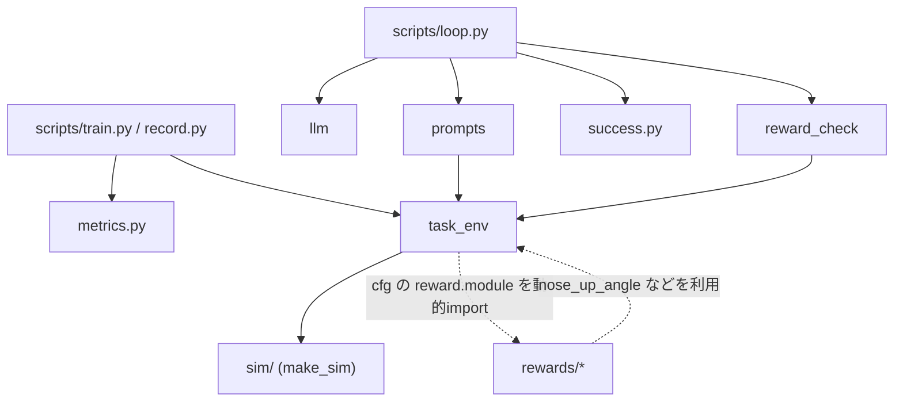

# pai_loop — 中核パッケージ

ロボットの**タスク環境**、報酬モジュールの**受け口**、LLM/VLMの**呼び出し**、**プロンプト**、報酬コードの**検証**をまとめたパッケージ。
スクリプト（[scripts](../scripts/README.md)）はすべてここを import して動く。

## ファイルと役割

| ファイル / ディレクトリ | 役割 |
|---|---|
| `task_env.py` | タスク環境 `TaskEnv`（rsl_rl の VecEnv 互換）。状態の読み出し、観測・報酬・終了判定・リセットを担う |
| `sim/` | シミュレータの抽象化（`QuadrupedSim`）と Genesis 実装。[詳細](sim/README.md) |
| `rewards/` | 報酬モジュール。手書きの `sit.py` と、LLMが生成した `generated/`。[詳細](rewards/README.md) |
| `reward_check.py` | LLMの返答から報酬コードを取り出し、ダミー状態で動作検証する |
| `metrics.py` | 録画した1エピソードから、芸に依存しない指標（姿勢・高さ・足・水平移動・ヨー・足の左右差・関節速度）を計算する。純Python（torch不要） |
| `success.py` | **凍結した数値の成功条件（YAML）**の検証と、指標への当てはめ（判定）。人の承認（`approved: true`）を要求する |
| `prompts.py` | 報酬を書くLLM用と、動画を評価するVLM用のプロンプトを組み立てる |
| `llm.py` | LLM/VLM呼び出しの共通インターフェース。現在は `claude -p` を使う `ClaudeCLI` |
| `__init__.py` | パッケージの説明のみ |

## モジュール間の依存



- `task_env.py` は **Genesis を直接 import しない**。`sim.make_sim(cfg["sim"], ...)` でバックエンドを得る。
- 報酬モジュールは `importlib.import_module(cfg["reward"]["module"])` で**設定から動的に読み込む**。
  環境のコードを変えずに、報酬だけを差し替えられる。
- `prompts.py` と `reward_check.py` は `task_env.TaskState` などに依存する（プロンプトに `inspect.getsource` で埋め込む、ダミー状態を作る）。

## task_env.py の流れ

**観測**（42次元）: 角速度(3、ボディ座標・スケール済み) + 重力方向(3、ボディ座標) +
関節角の既定姿勢からのずれ(12) + 関節速度(12、スケール済み) + 直前の行動(12)。

**行動**: 関節の目標角度の差分（12）。`目標 = 直前の行動 × action_scale + 既定の関節角度` をPD制御で追従させる。
**1ステップ遅れて**反映する（実機の遅延を模したもの）。

**1ステップ（`step`）**:

1. 行動を `clip_actions` でクリップし、シミュレータを1制御周期（`dt` = 0.02秒）進める
2. `TaskState`（報酬が読める状態）を作る。速度などは世界座標からボディ座標へ変換する
3. 報酬モジュールの `compute(state, params)` を呼び、**各項に `dt` を掛けて合計**する。項ごとの累積はログ用に保持する
4. 終了判定: `エピソード長の超過（time_out）` ｜ 報酬モジュールの `failed()` ｜ 物理ソルバの発散
5. 終了した環境だけをリセットし、`extras["episode"]` に項ごとの1秒あたりの平均（`rew_<項名>`）と `fail_rate` を出す
   （rsl_rl が `Mean episode rew_<項名>` としてログに出し、`loop.py` がこれを読み取る）
6. 観測を更新する

`extras["time_outs"]` は、時間切れによる終了を rsl_rl に伝える（失敗による終了と区別するため）。

**`TaskState`**（報酬が読める全情報）: `base_pos` / `base_quat` / `lin_vel_b` / `ang_vel_b` / `gravity_b` /
`dof_pos` / `dof_vel` / `default_dof_pos` / `feet_pos` / `actions` / `last_actions` / `episode_time`。
末尾が `_b` のものはボディ座標。`gravity_b` は水平時に (0, 0, -1)。

**ヘルパー**: `nose_up_angle(gravity_b)`（頭が高いと正のピッチ角）、`roll_angle(gravity_b)`、`quat_rotate_inverse`。
報酬モジュールは `from pai_loop.task_env import nose_up_angle, roll_angle` で使える。

## metrics.py と success.py

- `metrics.compute_metrics(log, dt, settle_s, n_failed)`: `scripts/record.py` が集めた毎ステップの記録（姿勢、位置、四元数、足の位置、関節速度）から、
  従来の平均値に加えて、ヨー角（巻き戻し済み）、開始位置からの最大距離、水平移動の総距離、前後の足の左右差、関節速度のRMS、0.1秒刻みの時系列を作る。
  ヨーは、機体が垂直に近い（ピッチが約70°を超える）間は定義できず、据え置く（`heading_valid_fraction` に割合を残す）
- `success.load_spec(path)`: 成功条件を読み、構造を検証する。未承認なら `NotApprovedError`。ハッシュ（SHA-256）も返す
- `success.evaluate(metrics, spec)`: 基準ごとに合否・実測値・余裕を返す。系列の基準は、窓内のサンプルのうち範囲内の割合が `min_fraction` 以上であること。
  指標が無い（旧い録画など）場合は「判定できない」として不合格にする
- 詳細と運用は [../docs/reward_and_evaluation.md](../docs/reward_and_evaluation.md)

## reward_check.py

- `parse_reply(text)`: 返答から `要点: ...` の行と ` ```python ` ブロックを取り出す。ブロックが無ければ例外
- `fake_state(n)`: ランダムなダミーの `TaskState`
- `load_and_check(path)`: 報酬モジュールを import し、次を検証する。違反は読みやすいメッセージの例外にする
  - `PARAMS` / `compute` / `failed` が存在する
  - `compute` が空でない dict を返し、各項が形 `(N,)` の有限なテンソルである
  - `failed` が形 `(N,)` の bool テンソルを返す
  - `PARAMS` の float が有限である

## prompts.py

| 名前 | 内容 |
|---|---|
| `REWARD_SYSTEM` | 報酬設計者としての役割と、出力形式（`要点:` と python コードブロック） |
| `ENV_SPEC` / `env_spec(cfg)` | 環境の説明（ロボット、周期、実測の高さ、関節順、`TaskState` のソース、報酬モジュールの仕様）。設定値とソースを埋め込む |
| `SUCCESS_NOTE` | 承認済みの成功基準を、報酬を書くLLMに伝える文（基準は変えられないことも明記） |
| `EVAL_SYSTEM` | 評価役（審査員）の役割。**報酬や学習設定は見えない**。出力はJSONのみ（`score` / `success` / `observations` / `problems` / `next_fix`。`next_fix` は動作・姿勢の観点で、報酬コードには触れない） |
| `reward_request(instruction, cfg, history, success_spec_text)` | 初回は「書いてください」、2回目以降は前回の報酬コード・学習終盤の各項の平均・エラー・**満たせなかった数値基準（実測値つき）**・動画評価・過去の修正指示を付けて「書き直してください」。成功基準のYAMLを含める |
| `eval_request(instruction, metrics)` | **盲検の採点依頼**。フレームの時刻と数値指標だけを渡す（報酬コード・各項の平均・数値判定は含めない）。画像の向きの取り違えを防ぐため、**数値（`nose_up_deg`）を優先**するよう指示する |

## llm.py

- `ClaudeCLI.ask(text, images, system)` — `claude -p` を `--safe-mode --tools ""`（CLAUDE.md・スキル・MCP・ツールを使わない）で起動し、
  `stream-json` で画像（base64）とテキストを渡す。戻り値は `LLMReply(text, seconds, cost_usd)`（費用はAPI換算の報告値）
- 例外: `LLMError`（失敗全般）、`LLMQuotaError`（利用枠の上限。ループはこれで停止し、リトライしない）
- `make_llm(name)` — バックエンドの切り替え口。現在は `"claude-cli"` のみ。利用枠が足りなくなったら、ここにAPI版を追加する想定
