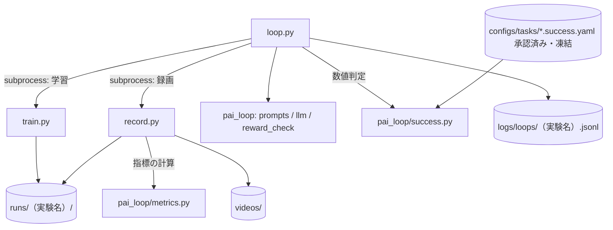

# scripts — 実行用スクリプト

リポジトリの**ルートから**実行する（相対パス `configs/`・`runs/`・`videos/`・`logs/` を前提にしている）。
どのスクリプトも `pai_loop` を import するため、先頭で親ディレクトリを `sys.path` に追加している。

## ファイルと役割

| ファイル | 役割 | 呼び出し元 |
|---|---|---|
| `loop.py` | **自動ループの指揮者**。報酬生成 → 学習 → 録画 → 数値判定とVLM評価を繰り返す。**承認済みの成功条件（`--success-spec`）が必須** | 人（コマンド） |
| `train.py` | 1つの設定で学習し、`runs/<exp>/` に結果を出す | `loop.py` または人 |
| `record.py` | 学習済みの方策を録画し、動画・指標・キーフレームを出す | `loop.py` または人 |
| `check_success.py` | 録画済みの指標を、成功条件に当てはめて判定する（GPU不要）。過去の実験の再判定や、条件の草案の検証に使う | 人 |

## 連携



`loop.py` は学習と録画を**別プロセス**（`subprocess`）で起動する。
受け渡しはファイルで行う: `train.py` が `runs/<exp>/summary.json` を、`record.py` が `runs/<exp>/metrics_<ckpt>.json` を書き、
`loop.py` がそれを読む。成功条件のYAMLは、人が承認した（`approved: true`）ものだけを読み、実行中に変わったら中止する。

## loop.py

```bash
python scripts/loop.py --exp demo_sit --instruction "お座りして" \
  --success-spec configs/tasks/sit.success.yaml --max-loops 3
```

`--success-spec` は必須。未承認（`approved: false`）の条件では起動を拒否する。

1周（`<exp>_L<i>`）の処理:

1. `prompts.reward_request` でLLMに報酬を依頼する（成功基準のYAMLを含める。2周目以降は、前回の報酬コード・各項の平均・エラー・**満たせなかった数値基準**・VLMの評価・過去の修正指示も含める）
2. 返答から報酬コードを取り出し、`pai_loop/rewards/generated/<exp>_L<i>.py` に保存して検証する。
   失敗したらエラー文を付けて再依頼する（最大 `--gen-retries` 回）
3. `base.yaml` に報酬を足した設定を `configs/<exp>_L<i>.yaml` に書く
4. `train.py`（タイムアウト `--train-timeout-s`）→ `summary.json` と、学習終盤の各報酬項の平均（ログから抽出）
5. `record.py`（タイムアウト `--record-timeout-s`）→ `metrics_<ckpt>.json`
6. **数値の成功判定**: 成功条件を指標に当てはめ、結果を `runs/<exp>/success_<ckpt>.json` に保存して表示する
7. **VLMの盲検採点**: フレーム画像と指標だけを渡し（報酬コード・報酬項・数値判定は見せない）、JSON（`score` / `success` / `observations` / `problems` / `next_fix`）を得る
8. 数値とVLMの判定を統合して `decision` を作る。食い違い（`numeric_pass_vlm_fail` / `numeric_fail_vlm_pass`）は記録して画面に表示する
9. 1行のJSONを `logs/loops/<exp>.jsonl` に追記する（報酬コード、学習結果、指標、数値判定、評価、決定、成功条件のハッシュ、LLM呼び出しの秒数・費用、エラー）

停止条件（`stop_reason`）:

| 値 | 条件 |
|---|---|
| `success` | **数値の成功判定が合格** かつ VLMが `success: true` で `score` が `--success-score`（既定8）以上 |
| `max_loops` | `--max-loops`（既定3）に到達 |
| `time_budget` | 開始から `--time-budget-s`（既定3600秒）を超えた（新しいループは始めない） |
| `llm_quota` | LLMの利用枠の上限に達した（リトライしない） |

生成・学習・録画・評価のどこかで失敗したループは、`error` を記録して**次のループへ進む**（エラーは次回のプロンプトに含まれる）。
終了時に、`stop_reason`・ループ数・LLM呼び出し回数・API換算費用・総時間・成功条件のハッシュ・食い違いの一覧をJSONで表示する。

主なオプション: `--base-config`、`--max-iterations`（学習を短縮して試す）、`--llm`、`--model`。

## train.py

```bash
python scripts/train.py configs/exp01_sit.yaml [--max-iterations N] [--num-envs N]
```

- 設定と報酬モジュールを `runs/<exp>/config.yaml`・`reward.py` にコピーする（再現用）。`runs/<exp>/` が既にあれば終了する
- Genesis をGPUで初期化し（`seed` を設定）、`TaskEnv` を作って rsl_rl の `OnPolicyRunner` で PPO 学習する
- `runs/<exp>/summary.json` に、実験名・シード・イテレーション数・環境数・学習時間・直近100エピソードの平均報酬・最後のチェックポイント番号・**gitのコミットID**を書く

## record.py

```bash
python scripts/record.py exp01_sit [--ckpt 300]
```

- `runs/<exp>/config.yaml` とチェックポイントを読み、**環境数1**で方策を動かして録画する（カメラはロボットを追従）
- 出力:
  - `videos/<exp>_<ckpt>.mp4`
  - `runs/<exp>/metrics_<ckpt>.json` — `settle_s` 秒以降の平均（前後の傾き、横の傾き、胴体の高さ、4本の足の高さ）、
    エピソード全体の値（水平移動の直線距離・最大距離・総距離、累積回転角、向きが定義できた割合、途中打ち切りの回数）、
    0.1秒ごとの時系列（姿勢、高さ、足の高さ、ヨー角、開始位置からの距離、前後の足の左右差、関節速度）、録画にかかった時間。
    計算は `pai_loop/metrics.py`
  - `runs/<exp>/frames_<ckpt>/t<秒>s.png` — キーフレーム（半分に縮小）。VLMに渡す画像
- 指標は特定の芸に依存しない量だけ。芸ごとの合否は、凍結した成功条件（`pai_loop/success.py`）が決める

## check_success.py

```bash
python scripts/check_success.py demo_sit_L2 --spec configs/tasks/sit.success.yaml [--ckpt 299] [--allow-unapproved]
```

- `runs/<exp>/metrics_<ckpt>.json` を読み、成功条件を当てはめて結果を表示し、`runs/<exp>/success_<ckpt>.json` に保存する。GPUは不要
- 終了コード: 合格=0、不合格=1、**判定できない（条件ファイルが不正・未承認、入力が無い）=2**（メッセージは標準エラーに出す）
- `--allow-unapproved` は、**未承認の草案を過去の実験で検証するためだけ**のフラグ。ループには存在しない
- 旧い版の `record.py` で作られたメトリクスには、新しい指標（ヨー・最大距離など）が無い。その基準は「判定できない」として不合格になる（録画し直す）
